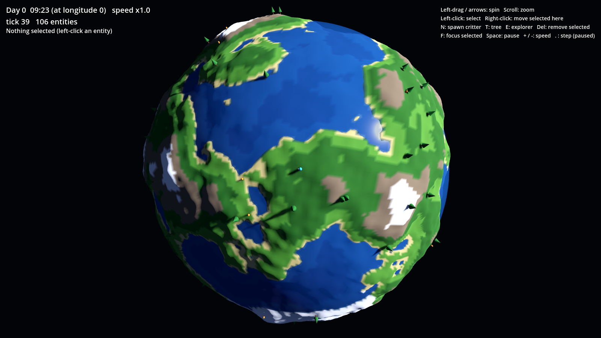

# Planet Sandbox

A small 3D planet you can watch and poke at. It has terrain with oceans,
mountains and ice caps, a day/night cycle with seasons, and creatures that
wander around during the day and rest at night. You can spawn things, select
them, and send them walking across the planet.



This is **step 1 of 4**. It is built so the next steps slot in cleanly:

1. **Core simulation** (this): planet, terrain, time, entities, commands.
2. **AI agent NPCs**: any AI model or scripted bot can observe the world and send commands.
3. **Multiplayer** and a hands-off "just watch" sim mode.
4. **Game mode** with goals and progression.

---

## How to run it

You need **Godot 4.5** (free, about 100 MB, no installer).

1. Download Godot 4.5 for your system from <https://godotengine.org/download>
   (the normal version, not the ".NET" one). Unzip it and open it.
2. Get this project on your computer. Either:
   - on GitHub, click the green **Code** button → **Download ZIP**, then unzip it, or
   - `git clone https://github.com/aidanwilhelm-hub/PlanetSandbox.git`
3. In Godot's Project Manager click **Import**, pick the `project.godot` file
   inside the project folder, then click **Import & Edit**.
   (The first time, Godot spends a few seconds preparing files. That's normal.)
4. Press **F5** (or the ▶ "Run Project" button in the top-right).

A window opens showing the planet.

### Controls

| Do this | To |
|---|---|
| Left-drag, or arrow keys | Spin around the planet |
| Mouse wheel | Zoom in / out |
| Left-click a thing | Select it (a yellow ring appears) |
| Right-click the ground | Send the selected thing walking there |
| **N** / **T** / **E** | Spawn a critter / tree / explorer where the mouse points |
| **Delete** (or **X**) | Remove the selected thing |
| **F** | Point the camera at the selected thing |
| **Space** | Pause / resume |
| **+** / **-** | Speed time up / slow it down (x0.25 to x32) |
| **.** | Advance one tick while paused |
| **Esc** | Deselect |

What lives here right now:

- **Explorer** (cyan, with a white nose): has no mind of its own. It walks
  wherever you send it. In step 2, AI agents will drive these.
- **Critter** (orange): wanders nearby by day, stops when its spot goes dark.
- **Tree** (green cone): scenery; it refuses to move.

Walkers can't swim: if a path crosses water they stop at the shore.

A full day is 2 minutes of real time at x1 speed, and a year is 8 days, so the
sun drifts north and south as the seasons change.

### Other ways to run it (from a terminal)

Replace `godot` below with the path to the Godot program you downloaded, and
run these from inside the project folder.

```bash
# Run the simulation with no window at all (prints a status line every 5 sim-seconds).
# This is what a dedicated multiplayer server will look like.
godot --headless --path . -- --server

# Try a different planet
godot --path . -- --seed=42

# Run the automated tests (no window). Prints PASS/FAIL per test.
godot --headless --path . --script res://tests/run_tests.gd
```

---

## How it's built (and why)

The single most important idea: **the simulation knows nothing about the screen,
and the screen never changes the simulation directly.**

```
   you / AI agent / remote player
                │  commands  ("move explorer 3 to lat 10, lon 45")
                ▼
   ┌───────────────────────────┐
   │  SimServer  (server/)     │   runs the sim at a fixed 20 ticks per second
   │   └─ Simulation (sim/)    │   validates commands, moves things, keeps time
   └───────────────────────────┘
                │  snapshots  (everything in the world + what just happened)
                ▼
   WorldView (client/)            draws the snapshot, turns clicks into commands
```

- **`sim/`**: the world itself, as plain data and rules. No graphics, no input.
  - `simulation.gd`: owns the world. `submit_command()` queues an order,
    `step()` advances one tick, `snapshot()` describes everything.
  - `planet.gd`: terrain heights and biomes, generated from a seed. Any machine
    with the same seed builds the identical planet, so terrain never has to be
    sent over the network.
  - `sim_clock.gd`: ticks, days, the sun's position, seasons.
  - `entity.gd`, `entity_kinds.gd`: what a "thing" is, and the catalog of kinds.
  - `commands.gd`: the only four ways to change the world: `spawn`, `despawn`,
    `move_to`, `stop`.
  - `brains/wander_brain.gd`: the critters' behavior. It doesn't move critters
    itself; it *sends commands* like anyone else would.
- **`server/sim_server.gd`**: runs the sim on a steady clock, handles pause and
  speed, and publishes snapshots.
- **`client/`**: everything you see: planet mesh, ocean, sun, camera, labels.
- **`tests/run_tests.gd`**: automated checks (determinism, rules, day cycle...).

### Commands

A command is a small dictionary, so it can come from a keyboard, a network
packet, or an AI model's JSON output:

```gdscript
{"type": "move_to", "issuer": "admin", "entity_id": 3, "target": {"lat": 10, "lon": 45}}
{"type": "spawn",   "issuer": "admin", "kind": "critter", "target": {"lat": -20, "lon": 100}}
{"type": "stop",    "issuer": "player:alice", "entity_id": 7}
{"type": "despawn", "issuer": "admin", "entity_id": 7}
```

Every command says who sent it (`issuer`). Each entity has a `controller`, and
only its controller (or `admin`) may command it. Bad or unauthorized commands
are refused with a reason (it shows up in the on-screen log) and never crash
the sim. In single-player, you are `admin`.

### Why this sets up the next steps

- **AI agents (step 2):** an agent reads a snapshot (it converts straight to
  JSON), decides, and sends commands. It gets its own `controller` name so it
  can only move its own explorer. The wander brain is a working example of this
  loop already.
- **Multiplayer (step 3):** the server already accepts commands from "anyone"
  and publishes snapshots. Step 3 adds the network pipe between them. The sim is
  deterministic (same seed + same commands = same world, checked by a test), and
  a "watch-only" viewer is simply a client that never sends commands.
- **Adding content:** a new creature is one line in `sim/entity_kinds.gd` plus
  (optionally) a look in `client/entity_visuals.gd`.
